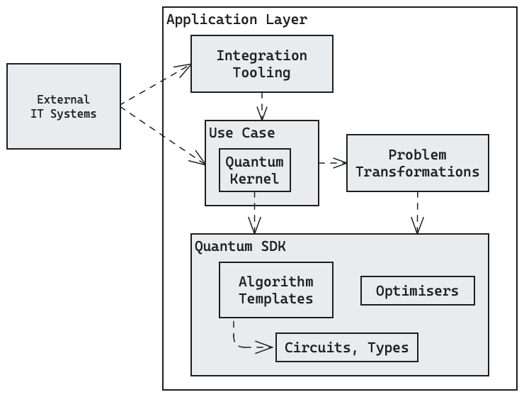

# Application Layer

<figure markdown="span">
  
</figure>

## Motivation

A lot of different software components exist that can be classified as part of
the Application Layer and the above figure presents a rough sketch of their
dependencies.
Most quantum software that is freely available today makes use of (usually
python-based) SDKs to build quantum circuits.
Furthermore, many tools exist for transforming various scientific, engineering
and commercial problems into quantum formulations, and there exist several tools
for configuring these transformations in a low-code manner.
Fully developed quantum solutions will likely have to implement a custom
component in the long term to interface between existing systems and the quantum
software stack.

## Contained Building Blocks

- **Use Case:** This component encapsulates the configuration of the quantum
  software stack for a specific use case.
  It is also responsible for interfacing with External IT Systems if the quantum
  application is to be integrated into an existing IT system
  (see [context section](../context-and-scope.md)).
  As the Use Case component characterises the interface between quantum and
  classical computation, it will have one or more dedicated
  [**Quantum Kernels**](../glossary.md#quantum-kernel) which encapsulate the
  parts of the program that are to be run on a quantum computer. 
  Use Case components are highly specific for the context and task they are used
  in.
  Reusable code will often live in the Quantum SDK or Problem Transformation
  libraries.
- **Integration Tooling**: Some tools specifically target the task of
  integrating quantum applications into existing IT infrastructure.
  This includes for example REST API wrappers for use cases, as implemented for example in
  [Kipu Quantum Hub's Services](https://docs.hub.kipu-quantum.com/services/using-a-service) or the
  [ProvideQ Toolbox's REST interface](https://api.provideq.kit.edu/webjars/swagger-ui/index.html)
  which improve the accessibility of quantum computing and provide
  standardised web APIs which can be integrated into typical IT
  infrastructure more easily.
  Integration tools typically depend on Use Case implementations which they
  wrap with their own abstractions and interfaces. 
- **Problem Transformations:** This component is symbolic for the many
  available tools for transforming scientific, engineering and commercial
  problems into quantum formulations (e.g. ProvideQ's Solvers, the
  [qubovert](https://qubovert.readthedocs.io/en/latest/) Python library, and
  [Qiskit Finance](https://github.com/qiskit-community/qiskit-finance)).
  Many of these tools directly use the Quantum SDK's building blocks.
- **Quantum SDK:** The Quantum SDK contains common building blocks for quantum
  software such as circuits and types (e.g.
  [qrisp's quantum variables](https://qrisp.eu/reference/Core/index.html#quantumvariable)),
  algorithm templates (e.g. VQE, QAOA, QPE) and optimisers (e.g. Adam or
  Rotosolve) for hybrid algorithms.
  Popular examples for Quantum SDKs include [Eclipse's qrisp](https://qrisp.eu),
  [IBM's Qiskit](https://github.com/Qiskit/qiskit) and
  [Xanadu's Pennylane](https://pennylane.ai).

## Important Interfaces
We have described the building blocks merely through an abstract
characterisation above, and we will characterise the interfaces between them in
a similar fashion:

* One major interface is provided by the Quantum SDK, the language that
  developers use to specify their quantum applications, and therefore, Use Case
  implementations, Problem Transformations depend on the chosen Quantum SDK.
  The [2025 Quantum Open Source Survey](https://unitaryfoundation.github.io/survey-2025/#Software)
  shows that there is currently no single favourite among the available
  Quantum SDKs, so to facilitate adoption of a standardised quantum software
  stack, it will be important to build integrations of multiple popular SDKs
  into the rest of the stack. <!-- TODO: quantum sdk to sys layer -->
* Use Case implementations and Problem Transformations provide highly individual
  interfaces since the problems they accept depend on their purpose.
* Integration Tooling can provide access to the Use Case implementations with a unified interface (e.g. for progress updates
  and configuration) but the data/payload types for the submitted problem
  instances are still specific to the Use Case implementation which it wraps. 
