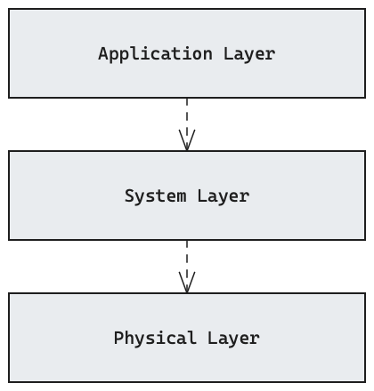

# Building Block View
The Building Block View shows the decomposition of the reference architecture
into types of software components and layers, as well as the dependencies
between them.
This allows stakeholders to gain an overview of how the system is organised,
which responsibilities each layer and each type of software component takes on,
and how they interact.

<figure markdown="span">
  
</figure>

## Motivation

Quantum software is highly complex, so we use a layered architecture to
decompose such systems into three layers: the Application, System, and Physical
Layer.
We rectify this decision with the following three perspectives:

- **Abstraction:** Software in the Application Layer is implemented on a high
  level and independently from concrete quantum devices.
  The System Layer compiles high-level specifications into device-specific
  instructions and software in the Physical Layer targets specific devices with
  low-level control.
- **Skills**: Developing software for the Application Layer requires abstract
  knowledge of quantum computing (e.g. the circuit model) but no understanding
  of its physical implementations is required.
  For working on the System Layer, developers need to have a broad understanding
  of various quantum device architectures and
  [deployment concerns](../deployment-view.md).
  Detailed knowledge for concrete quantum devices is required to program and
  operate quantum backends in the Physical Layer.
- **Operation**: In the Application Layer, manual programming or specification for
  individual use cases is required.
  Compilation in the System Layer is mostly automated with only high-level
  compilation settings needing to be configured.
  Execution on the Physical Layer is fully automated.

## Contained Building Blocks

### Application Layer
This layer will involve use-case-specific quantum and hybrid programs, written
in high-level languages using algorithms, SDKs and libraries.

#### Quality Characteristics

- The Application Layer must be extensible for new quantum and hybrid
  algorithms.
- The Application Layer must be extensible for new quantum programming
  abstractions.
- The Application Layer must be extensible for new quantum applications.

#### See also
* [Whitebox view of the Application Layer](./application-layer.md)

### System Layer
The System Layer is responsible for compiling high-level program specifications
from the Application Layer to low-level, device-specific instructions to be
executed in the Physical Layer, taking into account the quantum device
architecture (e.g. physical implementation such as superconducting or neutral
atom qubits, topology / connectivity)
and possibly HPC concerns.

#### Quality Characteristics

- The System Layer must be extensible for new quantum device architectures.
- The System Layer must be extensible for new quantum compilation passes.
- The System Layer should be extensible to work with different intermediate
  representations.
- The System Layer should minimise execution cost by optimising generated
  instructions.

#### See also
* [Whitebox view of the System Layer](./system-layer.md)

### Physical Layer
The Physical Layer executes the programs it receives from the System Layer by
controlling the physical quantum device.
It is also responsible for calibrating the device and monitoring it (e.g.
fidelities).

#### Quality Characteristics
- The classical co-processor must be able to run decoders in real-time.

#### See also
* [Whitebox view of the Physical Layer](./physical-layer.md)

## Important Interfaces
In the reference architecture, interfaces between the layers play a crucial role
in ensuring effective communication and interaction.
Well-defined interfaces enable
[modularity](../quality-requirements.md#maintainability-and-modularity),
[maintainability](../quality-requirements.md#maintainability-and-modularity), and
[extensibility](../quality-requirements.md#evolvability-and-extensibility) by
establishing clear boundaries between the concerns of individual layers.
Based on our [scenario-based analysis](../../scenario-based-analysis/index.md), we
derive a set of characteristics and identify key properties that the interfaces
between the respective layers should fulfill.

### Between the Application and System Layers
The interface between the Application and System Layers needs to serve the
following needs:

* It needs to transmit program specifications from the Application Layer to the
  System Layer.
  In the short term, low-level representations like OpenQASM or Qrisp's
  intermediate representation format will suffice but in the long term, programs
  written in high-level quantum programming languages (like
  [QPI](https://doi.org/10.1109/QCE60285.2024.10293)) will be transmitted,
  represented as their source code.
* It needs to allow submitting program specification for compilation and
  execution with suitable options available for configuring the compiler.
  Furthermore, the progress and results of execution and compilation tasks
  should be reported back to the Application Layer.

In the reference implementation, this interface will at first be realised with
[Qrisp's MLIR interface](https://qrisp.eu/reference/Jasp/MLIR%20Interface.html)
which currently supports low-level states and operations but is intended to
capture Qrisp's [high-level features](https://qrisp.eu/index.html#key-features)
at some point.
The concrete interface for submitting compilation and execution jobs is yet to
be determined.

### Between the System and Physical Layers
The interface between the System and Physical Layers needs to serve the
following needs:

* It needs to allow the System Layer to submit low-level quantum program
  specifications to the Physical Layer.
* It needs to allow the System Layer to query properties (like hardware
  architecture, instruction set, topology or gate fidelities) of the quantum
  device managed by the system layer.

In the reference implementation, the
[Quantum Device Management Interface (QDMI)](https://munich-quantum-software-stack.github.io/QDMI/)
will be used as its
[Job and Query interfaces](https://munich-quantum-software-stack.github.io/QDMI/latest/md_docs_2rationale.html)
satisfy these needs exactly.

??? info "Interaction patterns"

    We discuss typical interaction patterns between the System and Physical
    Layers in a [separate runtime view section](../runtime-view.md#sys-phys-interaction).
