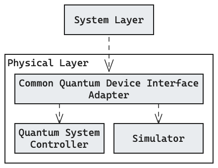

# Physical Layer

<figure markdown="span">
  
</figure>

## Motivation
The Physical Layer is responsible for the execution of quantum programs, either
on physical quantum hardware or a classical simulator.
Its implementation is highly dependent on the hardware architecture, vendor and
concrete device.
As such, the key architectural characteristic here is to either have the vendor
implement our interface towards the System Layer, or to implement an adapter
that translates our interface to the vendor's interface.

## Contained Building Blocks
* **Common Quantum Device Interface Adapter:** This component acts as a facade
  to the quantum device's internals by implementing the common quantum device
  interface used between the System and Physical Layer.
  If the quantum simulator or the quantum device firmware already implements the
  common quantum device interface, this component is not needed.
* **Quantum System Controller:** This component contains the firmware of the
  physical quantum device.
  It is responsible for controlling the physical quantum device, for example
  triggering lasers and sensors in superconducting hardware.
* **Simulator:** Instead of a physical quantum device with a Quantum System
  Controller the execution of the quantum program can also be carried out by a
  quantum computing Simulator running on classical hardware.
  A Physical Layer implementation will usually either have a simulator or a
  physical quantum device but not both. 

## Important Interfaces
- The common quantum device interface used by the System Layer to interact with
  the Physical Layer is described in the
  [overall system](./index.md) section.
- Within the Physical Layer, the protocols and interfaced used are highly
  dependent on the concrete quantum device or simulator.
  This dependency is hidden to the System Layer by the common quantum device
  interface.

The reference implementation's concrete interfaces between adjacent layers are
specified in the [overall system](./index.md) section.
