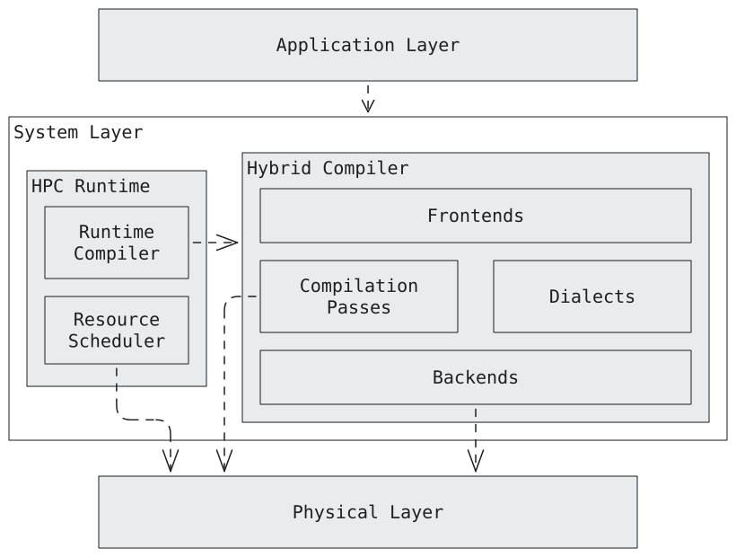

# System Layer

<figure markdown="span">
  
</figure>

## Motivation
The main task of the System Layer is compile translate high-level quantum
program specifications into low-level programs that can be executed on physical
quantum hardware.
Furthermore, the system layer also covers the integration into high-performance
computing (HPC) systems.
These two responsibilities are realised through separate building blocks:
the **HPC Runtime** component and the **Compiler** component.

## Contained Building Blocks

- **HPC Runtime:** This component covers the integration of quantum and hybrid
  programs into HPC systems.
  It includes the following components:
    - The **Runtime Compiler** is based on the full Hybrid Compiler component
      but focuses on compilation tasks which must be done during the runtime of a
      quantum HPC workload (e.g. re-optimising circuits instructions for changing
      properties of the hardware such as gate fidelities).
    - A specialised **Resource Scheduler** might be necessary to allow the HPC
      system to take into account [QPU](../glossary.md#quantum-processing-unit)
      resources.
- **Hybrid Compiler:** The purpose of a hybrid quantum compiler is to translate
  the high-level program specification from the application to low-level
  instructions executable on the physical layer.
  The term "hybrid" emphasises that such compilers will need to handle quantum
  programs but also the classical programs that surround them.
  It includes the following sub-components:
    - **Frontends:** Each frontend acts as a facade to the Hybrid Compiler that
      parses some program specification format (e.g. source code or an intermediate
      representation) into the internal program representation of the compiler.
      The term "frontend" is to be understood as a programming language frontend
      for the compiler (cf.
      [`gcc`'s page on frontends](https://gcc.gnu.org/frontends.html)), meaning
      frontends for different languages or SDKs could be integrated in the
      future.
    - **Dialects:** Hybrid Compilers will typically use various dialects
      (i.e. intermediate representation formats) to represent programs on
      different levels of abstraction.
    - **Compiler Passes:** Compiler Passes are at the heart of compilers.
      Each compiler pass transforms the structure of the program but compiler
      passes can serve different purposes.
      For quantum compilation, typical purposes include logical optimisation
      (e.g. reducing circuit size through gate cancellation), routing
      (i.e.&nbsp;adapting quantum programs to fit the limited connectivity of
      physical quantum devices) and quantum error correction (i.e., mapping a
      logical circuit to a fault-tolerant one with QEC primitives).
      Some compiler passes will use the Common Quantum Device Interface towards
      the Physical Layer to access data about compilation target.
    - **Backends:** Backends are responsible for lowering the intermediate
      representation of the compiled program to a format that the target device
      can understand.
      Each backend is responsible for one such format, and Hybrid Compilers will
      often have multiple backends to support multiple executable formats.

## Important Interfaces

- As discussed in the interfaces section for the
  [overall system](./index.md), the interface to the
  Application Layer needs to allow submitting program specifications for
  compilation and execution.
  There might be different formats (i.e. languages) for high-level program
  specifications and the compiler will be able to handle different formats
  through multiple Frontend components, one for each format.
- The [overall system](./index.md) interface section also
  discussed that the interface between the System and Physical Layer needs to
  allow querying device characteristics and submitting jobs.
  These capabilities are needed by the Quantum Compiler (for device-specific
  compilation) and Resource Scheduler (for job submission and resource
  allocation), respectively.
- Another important interface will be the plugin interface of the Quantum
  Compiler which will allow for proprietary extensions of the compilation task
  to contribute compilation passes or dialects.
- The remaining interfaces in the System Layer are internal.

The reference implementation's concrete interfaces between adjacent layers are
specified in the [overall system](./index.md) section.
The Quantum Compiler's plugin interface is still to be designed.
