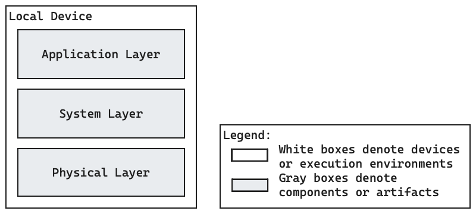
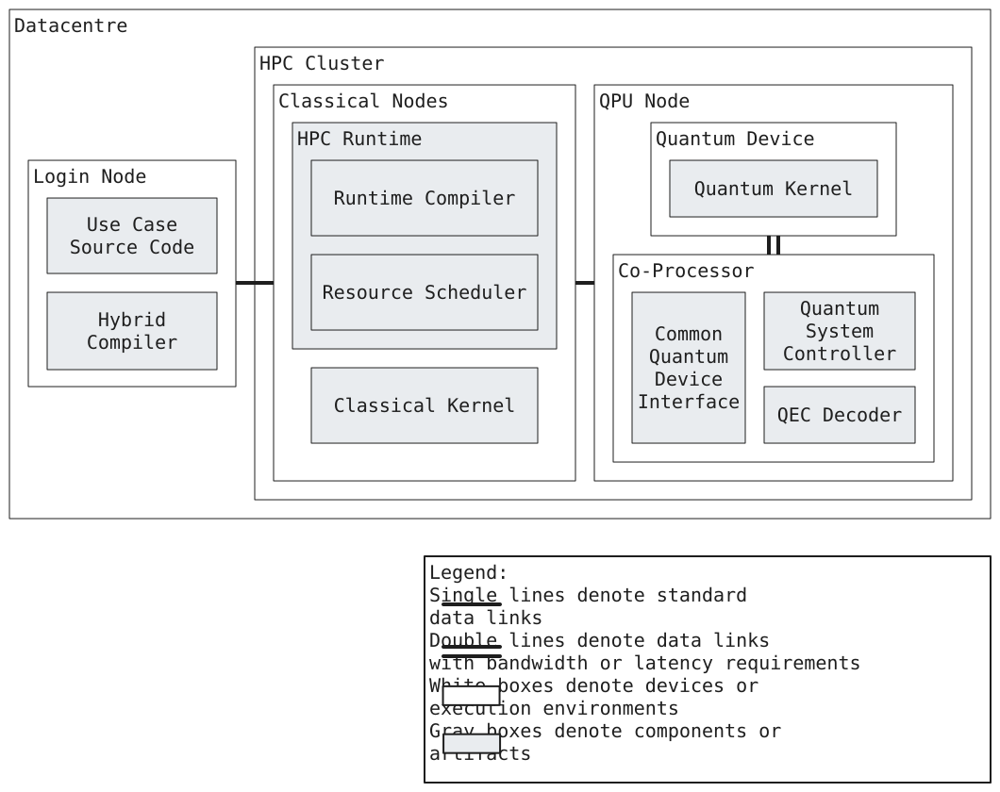

# Deployment View {#section-deployment-view}
The Deployment View provides an overview of the infrastructure requirements and the different ways in which a quantum software architecture can be realised in practice.
It describes the allocation of software components to computing resources, their communication interfaces, and their dependencies on specific infrastructure elements.
We visualise these aspects using the deployment on a single machine and on a HPC centre with integrated quantum hardware.

## Deployment on a Single Machine
<figure markdown="span">
  
</figure>

While developing quantum software, it is common try out the software on a local
machine.
In this most simple scenario, a full instantiation of the quantum software stack
is installed on a single non-quantum device such as a developer's laptop or
server.
As no quantum hardware is available in such a scenario, the physical layer
contains a simulator rather than actual quantum device firmware to execute
quantum kernels.

## Deployment in an HPC Centre
<figure markdown="span">
  
</figure>

It is a common belief in the quantum software community that quantum computers
will be most useful as accelerators in High-Performance Computing (HPC)
datacentres.
A key feature of HPC clusters is that they integrate enormous amounts of
computation resources (such as CPUs, GPUs, and potentially
[QPUs](./glossary.md#quantum-processing-unit)) to compute solutions to problems
that are otherwise impossible to solve.

For the execution of quantum software in an HPC environment, the following
execution environments are particularly important:

* The **Login Node** is a machine that acts as an entry point to the datacentre.
  It allows developers to bring the *Use Case Source Code* to the datacentre,
  to compile the *[Quantum Kernel](./glossary.md#quantum-kernel)* and
  *Classical Kernels* using the *Hybrid Compiler*
  (see&nbsp;[System Layer](./building-block-view.md#system-layer)), and to send
  them to the *HPC Cluster* for execution.
* The **HPC Cluster** is at the core of the datacentre.
  It is made up of many processing units, and storage facilities that allow
  running large workloads.
  We here distinguish between the following types of nodes: 
    * **Classical Nodes** such as CPUs, GPUs and other accelerators carry out
      classical workloads such as the *Classical Kernel* that was compiled on
      the login node.
      Beyond the actual workload, the Classical Nodes also host *HPC Runtime*
      components such as *Runtime Compilers* and *Resource Scheduler* which
      are responsible for distributing the workload onto the available
      resources.
      As discussed in the [System Layer](./building-block-view.md#system-layer),
      resource schedulers need to be equipped to deal with both classical and
      quantum workloads.
    * In the context of quantum software, **QPU Nodes** are of particular
      interest since they are responsible for executing quantum workloads such
      as the *[Quantum Kernel](./glossary.md#quantum-kernel)* that was compiled
      on the *Login Node*.
      **QPU Nodes** are made up of a physical **Quantum Device** (a.k.a.
      [QPU](./glossary.md#quantum-processing-unit) or quantum computer) and a
      **Co-Processor** that is located closely to the quantum device to enable
      low-latency and high-bandwidth communication between them.
      The Co-Processor is a classical computer <!-- TODO: or FPGA? --> that runs
      the **firmware** of the *Quantum Device* so that it can execute the
      compiled *Quantum Kernel*.
      If the firmware does not support the *Common Quantum Device Interface* on
      its own, an additional *Common Quantum Device Interface Adapter* component
      can adapt the firmware's own interface to the common one.
      The *Co-Processor* can also run other code that requires a
      [low-latency](./quality-requirements.md#latency) or high-bandwidth
      connection to the *Quantum Device* such as control flow
      or *[QEC Decoder](./runtime-view.md#qec-decoding-loop)* tasks.
