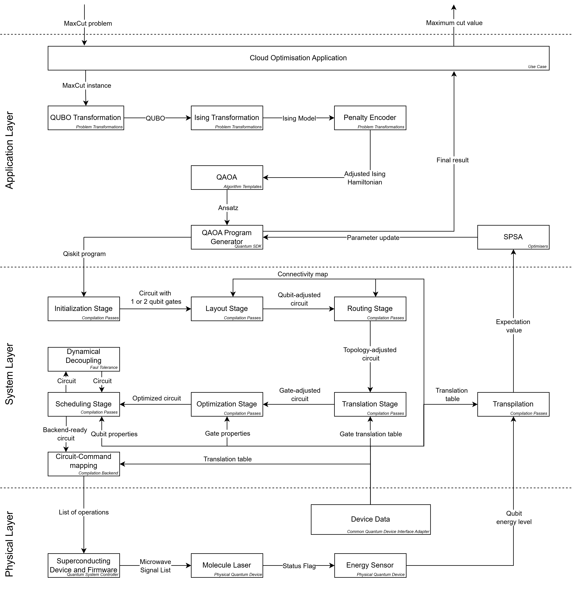

# Quantum Cloud Services for Optimisation Problems
In this scenario, we want to show how our architecture behaves and interacts using a NP-hard combinatorial optimisation problem. Since the System and Physical Layer are almost identical to the first scenario, we only document the new building blocks. 

It has the following specification:

- Input: Max-Cut instance
- Output: A cut consisting of a set of edges
- Used in:
    - Flight-gate assignment in airports
    - Electronic Design Automation
    - Trajectory optimization in air traffic

  

## Application Layer - Downwards                                                                
1. Cloud Optimisation Application ([Use Case](../reference-architecture/building-block-view.md#_white_box_app_layer))
    - Allows acccess for the stakeholder to the architecture.
    - Processes the MaxCut problem instance and forwards the problem information to the QUBO Transformator.

2. QUBO Transformator ([Problem Transformations](../reference-architecture/building-block-view.md#_white_box_app_layer))
    - Creates a QUBO, using the information of the Cloud Optimisation Application.

3. Ising Transformator ([Problem Transformations](../reference-architecture/building-block-view.md#_white_box_app_layer))
    - Transforms the QUBO into an Ising Hamiltonian.

4. Penalty Encoder ([Problem Transformations](../reference-architecture/building-block-view.md#_white_box_app_layer))
    - Checks if the required optimization problem needs a penalty factor and adjusts it.
     
5. QAOA ([Algorithm Templates](../reference-architecture/building-block-view.md#_white_box_app_layer))
    - QAOA is a hybrid algorithm which uses tunable parameters.
    - It encodes the Ising Hamiltonian into a quantum circuit.
   
6. QAOA Program Generator ([Quantum SDK](../reference-architecture/building-block-view.md#_white_box_app_layer))
    - With the parametrised circuit the program generator creates a program for the transpilation pipeline in the system layer.
 
## System Layer - Downwards
1. Noise Suppression ([Fault Tolerance](../reference-architecture/cross-cutting-concepts.md#fault-tolerance))
    - Noise Supression reduces the error rate by actively canceling noise using adjusted pulse timing or add redundancy to detect and reduce errors.
    - It takes an optimized circuit and adds the above mentioned operations.
   
   
## Physical Layer & System Layer - Upwards
Refer to the [quantum simulation scenario](./quantum-simulation.md) for a full explanation.

## Application Layer - Upwards
1. SPSA ([Optimisers](../reference-architecture/building-block-view.md#_white_box_app_layer))
    - SPSA is classical optimizer used for optimizing the parameters of the QAOA algorithm. 
    - It updates the parameters and sends them to the QAOA Program Generator, where the program is computed again until the optimizer terminates.
      
2. QAOA Program Generator ([Quantum SDK](../reference-architecture/building-block-view.md#_white_box_app_layer))
    - When the optimisers terminates, the final result is sent to the Cloud Optimisation Application
      
3. Cloud Optimisation Application ([Use Case](../reference-architecture/building-block-view.md#_white_box_app_layer))
    - Takes the final result as input and displays the MaxCut value
