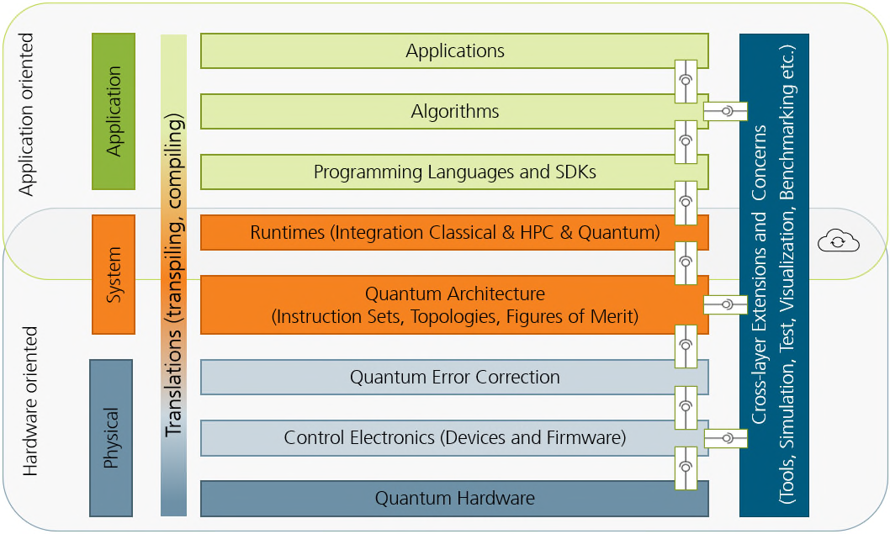

# Scenario-Based Analysis

## Background

Scenario-based analysis is an architecture evaluation method from classical
software engineering [^state-of-the-art-analysis].
It uses concrete usage scenarios for the system under design to verify whether the
architecture can hold up to the requirements of its use cases.

## Methodology

In FullStaQD, we use this method to guide the design of our
[reference architecture](../reference-architecture/index.md). At the current stage of the reference architecture, the scenario-based analysis focuses on the building block and runtime view. An extension to include the deployment view is planned for the future.
Additionally, we document the scenarios for other software architects to use them in the evaluation of their own
quantum software architecture instantiations, and for ourselves to evaluate
architectural decisions in future versions of our reference architecture. 

In order to use the scenario-based analysis, we evaluate the "Proto-Stack" which was designed in the QCNext project[^qc-next], a predecessor of the FullStaQD project. The Proto-Stack is visualized below:
  

Our set of scenarios was originally inspired by
[Carbonelli et al.'s work](https://doi.org/10.1007/978-3-031-64136-7_12) which
presented three industrial usage scenarios for quantum computing.
We have since adjusted our scenarios with the goal of covering a representative
set [^representative-study].
Our analysis currently covers the following scenarios:

1. [Quantum Simulation for Material Science, Chemistry and Physics](./quantum-simulation.md)
2. [Quantum Cloud Services for Optimisation Problems](./cloud-optimisation.md)
3. [Collision Detection using Quantum Machine Learning](./quantum-machine-learning.md)

To provide better orientation and clarify the relationships between individual software components, each component in the scenarios was retrospectively assigned to its corresponding building block of the [building block view](../reference-architecture/building-block-view/index.md). 

The results of the scenario-based analysis are embedded in many parts of the reference architectur, such as in the [Runtime View](../reference-architecture/runtime-view.md), [Building Block View](../reference-architecture/building-block-view.md), or in the [Cross-Cutting Concepts](../reference-architecture/cross-cutting-concepts.md). 

## Conclusion of the Scenario-based Analysis

### Separation of Concerns
-> hardware agnostic -> application
-> System layer transpilation alone is not enough
-> Hardware dependen _> physical
We also found that some thing cant be allocated in only one layer, ... When conducting the scenario-based analysis, we couldnt allocate fault tolerant methods at only one layer.
.. -> Crosslayer must exist

### Interface between the Application and System Layer {#app-sys-interface}
Why Program? Circuit alone is not enough

### Interaction between the System and Physical Layers {#sys-phys-interaction}
Hier über die 3 informationen sprechen und dass es konzepte gibt, die das zusammenfassen wie qdmi

Welche Konsequenzen können wir jetzt aus den gemeinsamkeiten/unterschieden ziehen?
We were able to identify important properties of the interfaces between all layers ….

Application to System: At least a circuit, ideally also zusätzliche befehle.
System to Physical: List of Operations including … -> vielleicht hier schon auf QDMI anspielen. 
Upwards:  easy…

Aufteilung der Software Komponenten in die Schichten empfanden wir als sinnvoll und auch gut, abgesehen von der Fault Tolerance. Da kann, je nach implementierung die Error Mitigation zwischen Application/System, Error Correction Physical/System (Vor allem QEC kann je nach Hardware (NV Zentren) auch im physical layer oder anders stattfinden) und Error Suppression Physical/System stattfinden, was für cross-layer concerns spricht. Es wird vermutet, dass andere Stakeholder perspektiven noch mehr cross-layer concerns erzeugen könten.

Eine reine Circuit übergabe von Application/System ist nicht genug. Da dort je nach implementierung ebenfalls andere fakten angegeben sein müssen, wie anzahl der shots, parameter von bspw hamiltonians, konfigurationen wie fault tolerance. oder auch das deployment. 

Application/System Layer ist due Übersetzung zur Quantenhardware nicht ausreichend, es benötigt noch scheduler, ressource management zu hpc bspw....

-> Vielleicht hier auch ein Kapitel hinzufügen
Results of other Stakeholder Views oder sowas...
Gerade sowas wie HPC im System Layer 
-> Skills die benötigt werden in den Schichten
-> Operations auf den Layern

Die Sachen aus der Doku halt, um die Separation of Concerns zu stärken...

[^state-of-the-art-analysis]: R. Kazman, G. Abowd, L. Bass and P. Clements [Scenario-based analysis of software architecture](https://doi.org/10.1109/52.542294) IEEE software 13.6 (1996)
[^representative-study]: Quantum Technology and Application Consortium–QUTAC et al. [Industry quantum computing applications](https://link.springer.com/article/10.1140/epjqt/s40507-021-00114-x) EPJ Quantum Technology 8.1 (2021)
[^qc-next]: QC Next – Development of a modular software stack for the commercial application of quantum computing:  [innovation concept](https://www.digital.iao.fraunhofer.de/en/competences/quantum-computing/innovation-concept-quantum-computing-software-stack-staqc.html) (2025)
