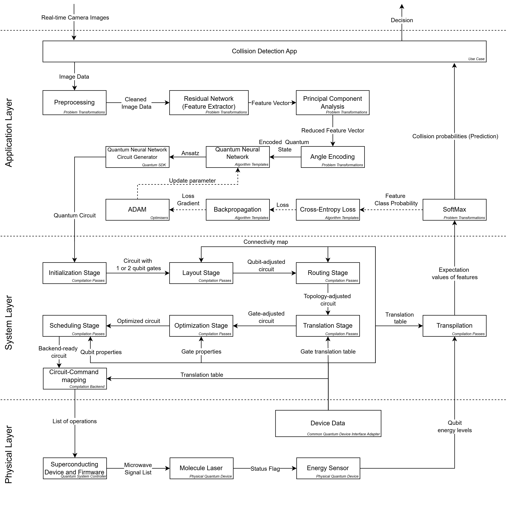

# Collision Detection using Quantum Machine Learning
This scenario covers how a Quantum Machine Learning (QML) collision detection use case maps to the layers of our architecture.
The figure below depicts the inference process with regular arrows and the training process with additional dotted arrows.

- Input: Real-time camera images
- Output: Action
- Used in:
    - autonomous driving
    - drones

  

## Application Layer - Downwards
1. Collision Detection App ([Use Case](../reference-architecture/building-block-view/application-layer.md))
    - Allows the access for the stakeholder.
    - Takes the real-time camera images and forwards the image data to the preprocessing.
   
2. Preprocessing ([Problem Transformations](../reference-architecture/building-block-view/application-layer.md))
    - Takes the image data as input and performs resizing, rescaling, color conversion, region-of-interest extraction and denoising.

3. Residual Network (ResNet) ([Problem Transformations](../reference-architecture/building-block-view/application-layer.md))
    - Trained ResNet Backbone uses the image data to extract the features of an image.
    - Creates a feature vector and forwards the Principal Component Analysis.

4. Principal Component Analysis (PCA) ([Problem Transformations](../reference-architecture/building-block-view/application-layer.md))
    - Due to the limitation in the number of qubits, this step reduces the number of features in the feature vector.
      
5. Angle Encoding ([Problem Transformations](../reference-architecture/building-block-view/application-layer.md))
    - Encodes each feature using rotational gates.
    - Creates an encoded quantum state.
   
6. Quantum Neural Network ([Algorithm Templates](../reference-architecture/building-block-view/application-layer.md))
    - Appends a variational quantum circuit to the encoded quantum state.
      
7. Quantum Neural Network Program Generator ([Quantum SDK](../reference-architecture/building-block-view/application-layer.md))
    - Creates a circuit of the variational quantum circuit and the encoded state.
    - Sends the circuit to the System Layer.
      
## System Layer & Physical Layer
Refer to [quantum simulation scenario](./quantum-simulation.md) for a full explanation.

## Application Layer - Upwards

8. Softmax Function ([Problem Transformations](../reference-architecture/building-block-view/application-layer.md))
    - Transforms expectation values of each feature into probabilities.
    - Gives the Collision Detection App a collision probability.
    
9. Collision Detection App ([Use Case](../reference-architecture/building-block-view/application-layer.md))
    - Gets the collision probability from the SoftMax Function and decides for an action. 
    
9. Cross-Entropy Loss (training only) ([Algorithm Templates](../reference-architecture/building-block-view/application-layer.md))
    - Calculates the loss of the probabilities of the features.
       
10. Backpropagation (training only) ([Algorithm Templates](../reference-architecture/building-block-view/application-layer.md))
    - Takes in the loss of the features and calculates the loss gradient.
      
11. Adaptive Moment Estimation (ADAM) (training only) ([Optimisers](../reference-architecture/building-block-view/application-layer.md))
    - Uses the loss gradient to optimize the parameter of the quantum neural network.
