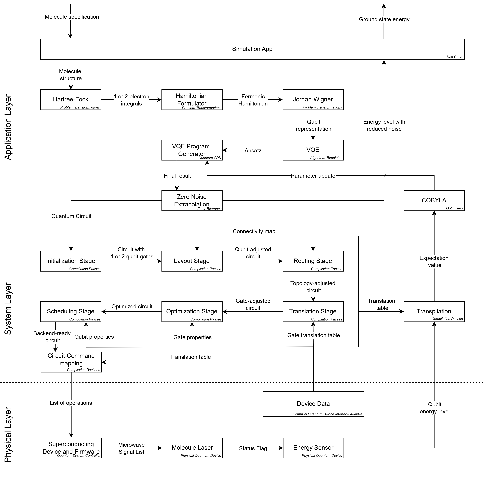

# Quantum simulation for material science, chemistry and physics

This scenario describes the how quantum computing can be used for material science, chemistry and physics. 

It has the following specification:

-  Input: molecule specification
-  Output: ground state energy
-  Used in:
    - material science
    - battery design
    - catalyst research

  

## Application Layer - Downwards

1. Simulation App ([Use Case](../reference-architecture/building-block-view/application-layer.md))
    - The Simulation App is the entry point for this scenario.
    - It takes the molecule specification and passes it down to the Hartree-Fock algorithm.

2. Hartree-Fock ([Problem Transformations](../reference-architecture/building-block-view/application-layer.md))
    - The Hartree-Fock algorithm is the first transformation step to get from the molecule input to a quantum ready representation.
    - Its input is the molecular geometry in our scenario.
    - The output are the electron integrals.

3. Hamiltonian Formulator ([Problem Transformations](../reference-architecture/building-block-view/application-layer.md))
    - The Hamiltonian formulation maps the electron integrals into a fermonic Hamiltonian.

4. Jordan-Wigner ([Problem Transformations](../reference-architecture/building-block-view/application-layer.md))
    - The Jordan-Wigner Transformation allows a qubit representation using a fermonic Hamiltonian and turns it into a spin Hamiltonian, which is equivalent to a set of qubits.
     
5. Variational Quantum Eigensolver (VQE) ([Algorithm Templates](../reference-architecture/building-block-view/application-layer.md))
    - The VQE Algorithm is a hybrid algorithm, which uses the qubit Hamiltonian to create a parameterised quantum circuit.

6. VQE Circuit Generator ([Quantum SDK](../reference-architecture/building-block-view/application-layer.md))
    - The circuit generator creates the final parametrised circuit for the transpilation pipeline in the system layer.
 
## System Layer - Downwards

The [Qiskit Transpilation Pipeline](https://quantum.cloud.ibm.com/docs/en/guides/transpile) consists of 6 steps:

1. Initialization Stage ([Compilation Passes](../reference-architecture/building-block-view/system-layer.md))
    - Using the quantum program from the Application Layer, the transpilation pipeline can start.
    - The first step of the transpilation pipeline is breaking down multi- and custom made qubit- gates into one- or two-qubit operations.
      
2. Layout Stage ([Compilation Passes](../reference-architecture/building-block-view/system-layer.md))
    - This stage maps the input circuit's virtual qubits to the target's physical hardware qubits.
    - The algorithm's goal is to map the qubits in such a way that frequently-interacting virtual qubits end up next to each other in the physical hardware. 

3. Routing Stage ([Compilation Passes](../reference-architecture/building-block-view/system-layer.md))
    - As described in the step before, a perfect connectivity between the qubits can not always be achieved. Therefore this stage adds additional operations to adapt to these constraints.
    - Using the circuit and hardware topology as inputs, it can create a physically compatible circuit by inserting SWAP gates to move information between previously disconnected qubits.

4. Translation Stage ([Compilation Passes](../reference-architecture/building-block-view/system-layer.md))
    - This stage rewrites all previously chosen gates into the specific native gates supported by the target hardware's Instruction Set Architecture (ISA). 

5. Optimization Stage ([Compilation Passes](../reference-architecture/building-block-view/system-layer.md))
    - This stage executes low-level, hardware-aware refinements on circuits that are already compatible with the target's Instruction Set Architecture (ISA) to reduce redundancy.

6. Scheduling Stage ([Compilation Passes](../reference-architecture/building-block-view/system-layer.md))
    - The scheduling stage receives an ISA-compatible circuit and inserts explicit delay instructions to accurately reflect qubit idle periods, hardware timing constraints and to reduce error rate.
    - It ensures the final output remains ISA-compatible while updating start-time metadata and optionally applying walltime-sensitive transformations.
    - This concludes the Qiskit transpilation pipeline.

7. Circuit-Command Mapping ([Compilation Backend](../reference-architecture/building-block-view/system-layer.md))
    - Using the ISA-compatible circuit, additional information like number of measurements demanded and a translation table, which translated the commands into backend compatible commands, this steps gives a list of operations to the device and firmware of the hardware.

## Physical Layer 

1. Superconducting Device and Firmware ([Quantum System Controller](../reference-architecture/building-block-view/physical-layer.md))
    - Using digital hardware instructions and pulse definitions, this process converts these commands into physical signals to control operations on the quantum chip. 
    - It outputs a microwave signal list directly to the quantum hardware, translating digital instructions into executable physical actions.
    
2. Molecule Laser ([Physical Quantum Device](../reference-architecture/context-and-scope.md#_business_context))
    - The molecule laser uses the microwave signal list to execute the quantum operations on the physical hardware.
    - When all operations are done, the molecule Laser sends a status flag to the energy sensor.

3. Energy Sensor ([Physical Quantum Device](../reference-architecture/context-and-scope.md#_business_context))
    - When the molecule laser has completed its job and updated its status, this step measures the qubit energy levels.

## System Layer - Upwards 

1. Transpilation ([Compilation Passes](../reference-architecture/building-block-view/system-layer.md))
    - In this step, the qubit energy levels are transformed into an expectation value.
    - To do this, additional backend data is needed to interpret the measured results.

## Application Layer - Upwards 

1. COBYLA ([Optimisers](../reference-architecture/building-block-view/application-layer.md))
    - COBYLA is a classical optimizer which needs an expectation value as input.
    - It compares the expectation value to the last one (if it exists) and tries to optimize the parameters of the VQE algorithm.
    - After an local optimal solution is found or the maximum of iterations is reached, the classical optimizer terminates.
      
2. VQE Program Generator ([Quantum SDK](../reference-architecture/building-block-view/application-layer.md))
    - The Program Generator updates the parameters of the COBYLA algorithm and starts the process again.
    - When the classical optimiser terminates, the VQE Program Generator gives the optimal result towards the Error Mitigation method.
      
3. Zero Noise Extrapolation  ([Fault Tolerance](../reference-architecture/cross-cutting-concepts.md#fault-tolerance))
    - Zero Noise Extrapolation (ZNE) is an error mitigation method, which can reduce the error rate by using an expectation value and a circuit has input.
    - It creates a program to measure a new expectation value with a circuit, which has still the same function but uses more gates. 
    - This process is repeated multiple times and lead towards a noise pattern, which allows to reduce the error rate by extrapolation.
    
4. Simulation App ([Use Case](../reference-architecture/building-block-view/application-layer.md))
    - The error-optimized expectation value is given towards the simulation app, which then visualize it as ground state energy for the user.
